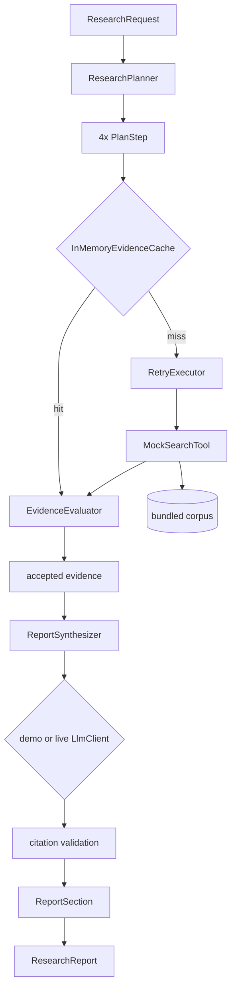

# Architecture

## Components

| Component                    | Responsibility                                                              |
|-------------------------------|--------------------------------------------------------------------------------|
| `ResearchPlanner`              | Question → 4 structured `PlanStep`s                                          |
| `SearchTool` / `MockSearchTool`| Retrieves `Evidence` for one sub-question from the bundled corpus            |
| `InMemoryEvidenceCache`        | TTL cache around tool calls, keyed by (tool, sub-question, query)            |
| `RetryExecutor`                | Generic exponential-backoff wrapper around any fallible call                 |
| `EvidenceEvaluator`            | Scores relevance/credibility/recency; gates what may be cited                |
| `ReportSynthesizer`            | Produces a `ReportSection`; re-validates every citation independently        |
| `DemoLlmClient`                | Deterministic, template-based synthesis (default, no network)                |
| `OpenAiCompatibleLlmClient`    | Optional live synthesis backend (gated behind config, env-var API key only)  |
| `ResearchAgentService`         | Orchestrates the full pipeline and assembles the `ResearchReport`            |
| `ResearchController`           | `POST /api/research`, `GET /api/research/sample`                             |

## Data Flow



### ASCII fallback

```
ResearchRequest
      |
      v
ResearchPlanner --> 4x PlanStep
      |
      v (per step)
InMemoryEvidenceCache --miss--> RetryExecutor --> MockSearchTool --> corpus
      |--hit-------------------------------------------------------------^
      v
EvidenceEvaluator (relevance + credibility + recency) --> accepted evidence
      |
      v
ReportSynthesizer --> LlmClient (demo or live) --> citation validation
      |
      v
ReportSection  x4  -->  ResearchReport (+ costSummary, confidence, caveats)
```

## Important Interfaces

- `SearchTool` is the seam for a real provider — implement it, register it
  as the `@Primary` Spring bean, and nothing else in the pipeline changes.
- `LlmClient` is the seam for a real synthesis backend. Critically,
  `ReportSynthesizer` does not trust *either* implementation's citations —
  it re-checks every claimed id against the evidence that specific call was
  given, every time.

## External Dependencies

- Spring Web, Spring Validation (runtime)
- Spring Boot Test (JUnit 5, Mockito, AssertJ — test scope only)
- `java.net.http.HttpClient` (JDK built-in) for the optional live LLM client
  — no HTTP client library dependency needed
- No vector database, no embeddings provider, no required external service

## Decision Points

- **Where citation validation lives**: in `ReportSynthesizer`, not in either
  `LlmClient` implementation. This means a hallucinated citation is
  impossible to surface in the final report regardless of which synthesis
  backend produced the text — the guarantee doesn't depend on trusting the
  LLM integration to behave.
- **Why caching wraps retry, not the other way around**: a cache hit should
  skip the tool call (and therefore any retry logic) entirely; only a cache
  miss should pay the retry cost.
- **Why the cost summary reports estimated tokens even in demo mode**: no
  real LLM call is made in demo mode, so there's no real token bill — but
  the estimate (from evidence text volume) demonstrates the accounting
  mechanism that would report real numbers once `OpenAiCompatibleLlmClient`
  is active.
